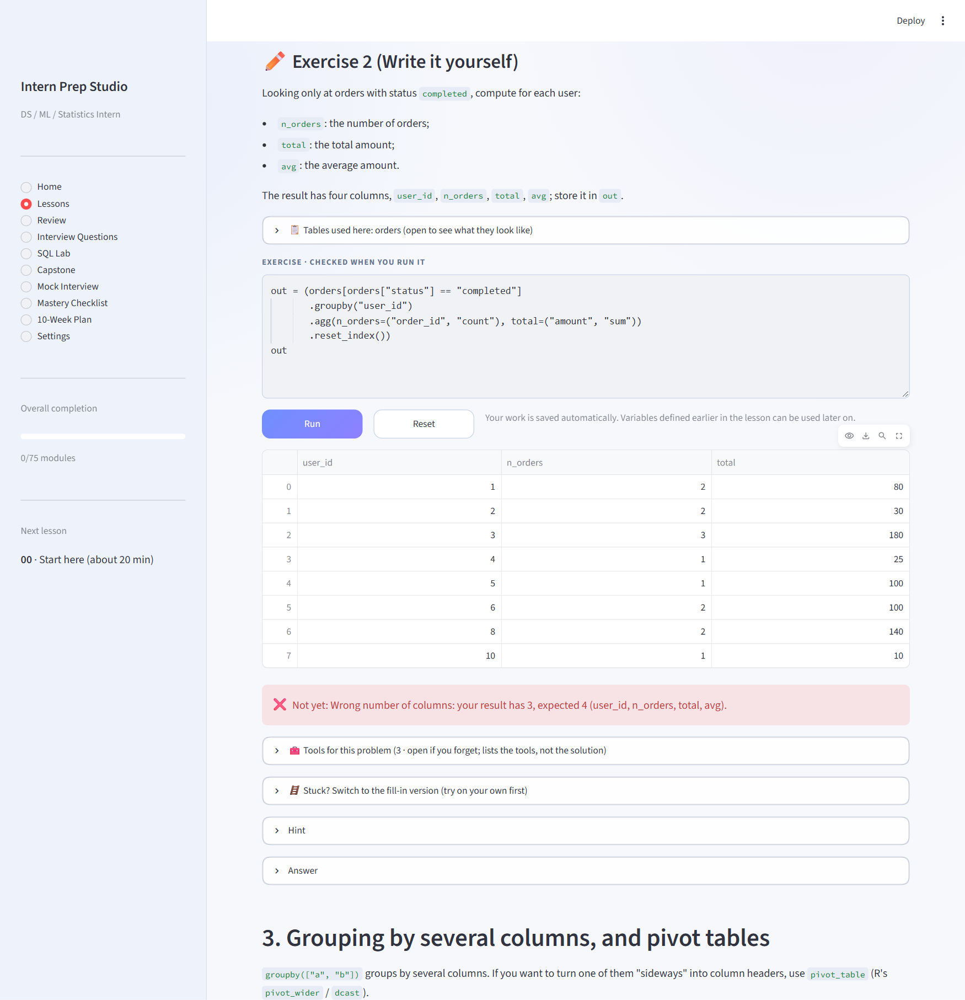

# Intern Prep Studio

A self-paced, local web app for preparing for **data science, machine learning, and statistics internship interviews and online assessments (OAs)**.

It teaches Python, pandas, and SQL from scratch, with side-by-side R equivalents throughout. It then reviews the statistics and ML that interviews actually test: probability, inference, regression, A/B testing, model evaluation, and case questions. Exercises run in the browser and are graded automatically.



## What's inside

There are 75 lessons in 16 chapters, about 57 hours in total:

| Chapter | Content |
|---|---|
| 00–01 | How to use the app; Python basics (8 lessons) and 80 Python drills |
| 02 | NumPy and pandas (6 lessons) and 100 pandas drills |
| 03 | SQL (6 lessons with a live SQLite practice database) and 80 SQL drills |
| 04 | Algorithms and a timed mock OA (10 lessons) and 60 algorithm drills |
| 05–09 | Probability, statistical inference, linear regression, logistic regression and regularization, A/B testing. Each chapter has an oral-review lesson, a hands-on Python lesson, and 20 drills. |
| 10–11 | Machine learning workflow, model evaluation, and ML algorithms from scratch (AUC, kNN, k-means, gradient descent) |
| 12–13 | DS case studies and product sense; research communication and behavioral questions |
| 14–15 | Three final reviews (oral, full mock OA, stats/ML calculations) and an optional baseline diagnostic |

Each coding lesson follows the same progression: **explanation → worked example → modify it → fill in the blanks → write it yourself**.

Clicking **Run** on an exercise checks it with hidden tests. The feedback says what is wrong, for example "your result has 3 rows, expected 4", not just "incorrect".

Each exercise also has optional help panels:

- **💡 Hint**
- **🧰 Tools for this problem**: the functions the answer uses, each with a one-line reminder and a link back to the lesson that taught it
- **🪜 Fill-in version**: the answer with its key pieces blanked out
- **Answer**

Beyond the lessons, the app has:

- **Review**: a spaced-repetition queue of exercises to rewrite from scratch
- **Interview Questions**: a random draw from a question bank
- **SQL Lab**: a free-form SQL editor
- **Capstone**: an end-to-end project on an 8,000-user synthetic experiment dataset (data audit → SQL → experiment analysis → predictive model)
- **Mock Interviews**, a **Mastery Checklist**, and a **10-Week Plan**

## Running it

Requires Python 3.10+.

```sh
pip install -r requirements.txt
streamlit run app.py
```

You can also start it without a console window:

- **Windows:** double-click `Intern Prep Studio.vbs`.
- **macOS:** run `zsh scripts/build_mac_app.sh` once to create a double-clickable `.app`.

Closing the browser tab stops the server a few seconds later (`autoshutdown.py`).

Your progress, notes, and code are saved locally in `user_data/`, which is git-ignored. A backup of that folder is made automatically every day.

## Project layout

```
app.py                 Streamlit app: pages, code runner, grading, review queue
toolbox.py             Builds the "Tools" and "Fill-in" panels from each reference answer
check_helpers.py       Grading helpers with readable feedback (same_frame, expect_close, ...)
practice_data.py       In-memory SQLite practice database and capstone data loaders
notebooks/             The 75 lessons as Jupyter notebooks (also readable on GitHub)
course_manifest.json   Lesson order, titles, and time estimates
data/                  Practice tables (SQL seed) and the synthetic capstone dataset
scripts/               Capstone data generator and launcher helpers
tests/                 Notebook validator: runs every lesson and checks every reference answer
```

All data is synthetic. `scripts/generate_capstone_data.py` regenerates the capstone dataset from a fixed seed.

## Testing

```sh
python tests/validate_notebooks.py
```

The validator runs each lesson the way the app does:

- code cells share one namespace;
- each exercise's reference answer runs and is graded against its hidden check;
- each SQL solution runs against the practice database;
- each read-only drill's printed output is compared with the output shown in the lesson.

## License

MIT
